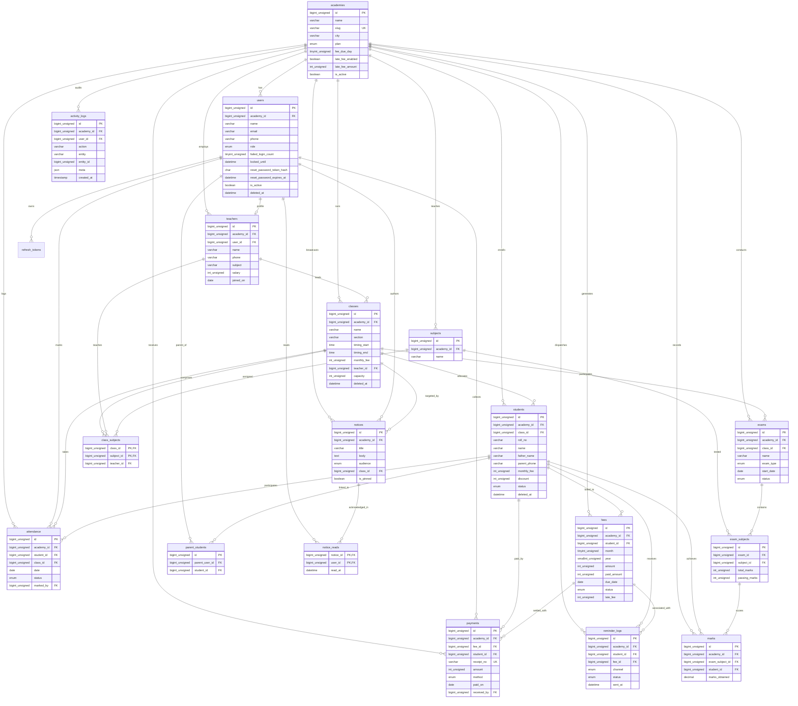

# Tuition Academy Manager — Entity Relationship Diagram (ERD) & Indexing Guide

Database architecture for **Academy Manager SaaS** running on **MySQL 8.0+ (InnoDB, utf8mb4, utf8mb4_unicode_ci)**.

---

## 1. Complete Entity Relationship Diagram (Mermaid)



---

## 2. Five Most Critical Queries & Supporting Indexes

### Query 1: Student Directory Search & Filter with Pagination
Used on `/students` to search by name/roll number and filter by class and status.

```sql
SELECT s.id, s.roll_no, s.name, s.father_name, s.parent_phone, s.status, s.monthly_fee, c.name AS class_name
FROM students s
JOIN classes c ON s.class_id = c.id
WHERE s.academy_id = 1 
  AND s.class_id = 4 
  AND s.status = 'active'
  AND s.deleted_at IS NULL
ORDER BY s.roll_no ASC
LIMIT 10 OFFSET 0;
```
* **Supporting Indexes**:
  * `idx_students_academy_id (academy_id)`
  * `idx_students_class_id (class_id)`
  * `idx_students_status (status)`
  * `idx_students_deleted_at (deleted_at)`
  * `uq_students_academy_roll (academy_id, roll_no)`

---

### Query 2: Daily Attendance Sheet & Bulk Marking Lookup
Used on `/attendance` to load all students in a class with today's attendance status.

```sql
SELECT s.id AS student_id, s.roll_no, s.name, COALESCE(a.status, 'present') AS today_status, a.note
FROM students s
LEFT JOIN attendance a ON a.student_id = s.id AND a.date = '2026-11-06'
WHERE s.academy_id = 1 
  AND s.class_id = 4 
  AND s.status = 'active'
  AND s.deleted_at IS NULL
ORDER BY s.roll_no ASC;
```
* **Supporting Indexes**:
  * `idx_attendance_class_date (class_id, date)`
  * `uq_attendance_student_date (student_id, date)`
  * `idx_students_class_id (class_id)`

---

### Query 3: Monthly Fee Ledger, Overdue Status & WhatsApp Reminders
Used on `/fees` to identify students with pending or overdue fee balances for reminder dispatch.

```sql
SELECT f.id AS fee_id, s.id AS student_id, s.name, s.parent_phone, f.month, f.year,
       f.amount, f.paid_amount, (f.amount - f.paid_amount) AS balance_pkr, f.status, f.due_date
FROM fees f
JOIN students s ON f.student_id = s.id
WHERE f.academy_id = 1
  AND f.year = 2026 
  AND f.month = 11
  AND f.status IN ('pending', 'partial', 'overdue')
ORDER BY f.due_date ASC;
```
* **Supporting Indexes**:
  * `idx_fees_academy_status (academy_id, status)`
  * `idx_fees_period (year, month)`
  * `idx_fees_due_date (due_date)`
  * `uq_fees_student_month_year (student_id, month, year)`

---

### Query 4: Parent Portal Dashboard (Child Performance & Vouchers)
Used on `/parent` to retrieve all children linked to a parent account along with attendance & fee status.

```sql
SELECT s.id AS student_id, s.name, s.roll_no, c.name AS class_name,
       f.status AS current_fee_status, f.amount AS fee_due,
       (SELECT COUNT(*) FROM attendance att WHERE att.student_id = s.id AND att.status = 'present') AS total_presents,
       (SELECT COUNT(*) FROM attendance att WHERE att.student_id = s.id) AS total_marked_days
FROM parent_students ps
JOIN students s ON ps.student_id = s.id
JOIN classes c ON s.class_id = c.id
LEFT JOIN fees f ON f.student_id = s.id AND f.month = 11 AND f.year = 2026
WHERE ps.parent_user_id = 101 AND s.deleted_at IS NULL;
```
* **Supporting Indexes**:
  * `idx_parent_students_parent_user (parent_user_id)`
  * `idx_parent_students_student (student_id)`
  * `uq_fees_student_month_year (student_id, month, year)`

---

### Query 5: Exam Result Cards & Class Grade Distribution
Used on `/results` to aggregate marks per subject and compute percentage and ranks.

```sql
SELECT s.id AS student_id, s.roll_no, s.name,
       sub.name AS subject_name, es.total_marks, es.passing_marks,
       m.marks_obtained,
       ROUND((m.marks_obtained / es.total_marks) * 100, 1) AS percentage
FROM exam_subjects es
JOIN subjects sub ON es.subject_id = sub.id
JOIN marks m ON m.exam_subject_id = es.id
JOIN students s ON m.student_id = s.id
WHERE es.exam_id = 1 AND m.academy_id = 1
ORDER BY s.roll_no ASC, sub.name ASC;
```
* **Supporting Indexes**:
  * `idx_exam_subjects_exam_id (exam_id)`
  * `idx_marks_exam_subject_id (exam_subject_id)`
  * `idx_marks_academy_id (academy_id)`
  * `uq_marks_exam_subject_student (exam_subject_id, student_id)`

